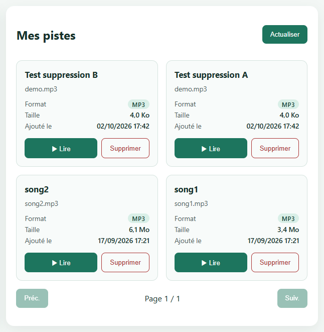
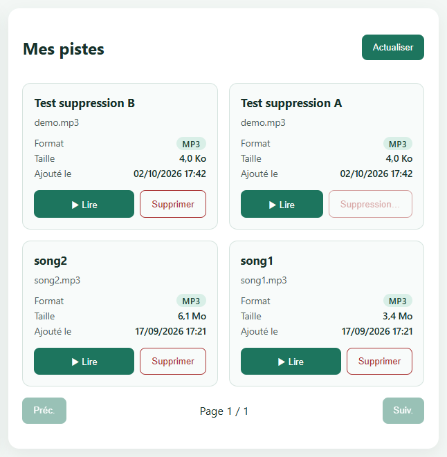
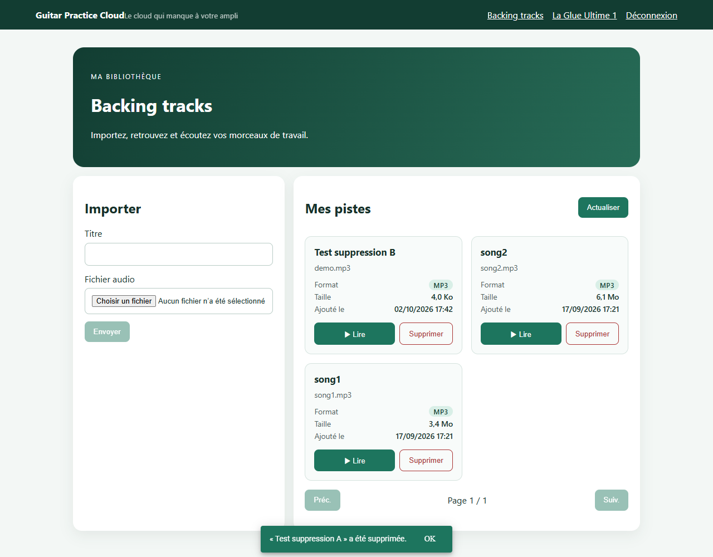
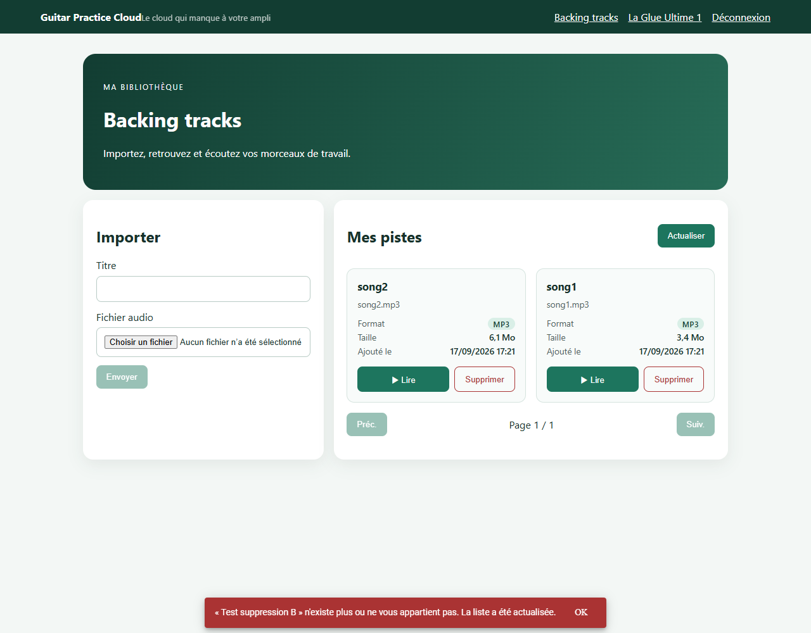
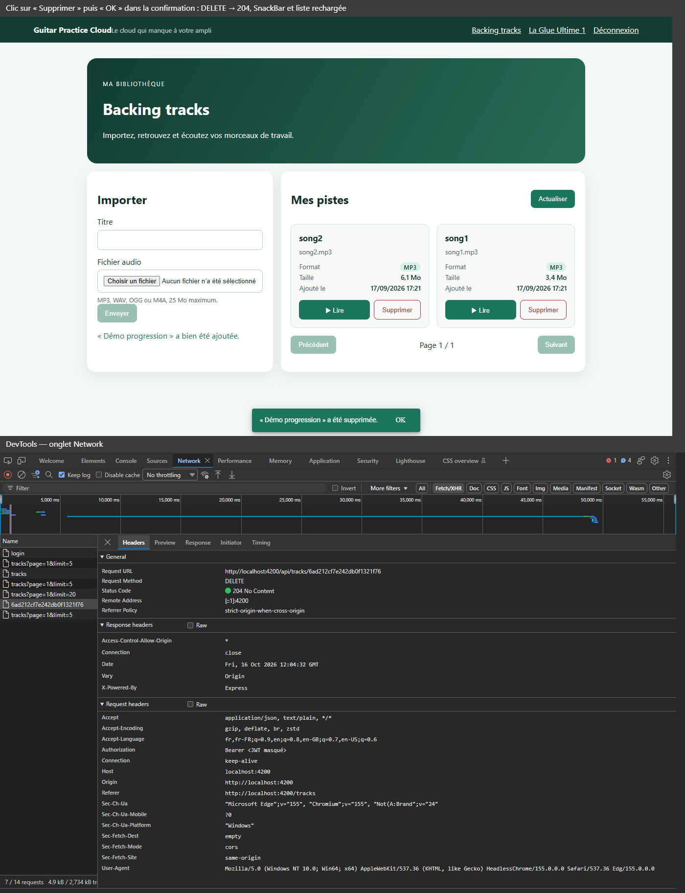
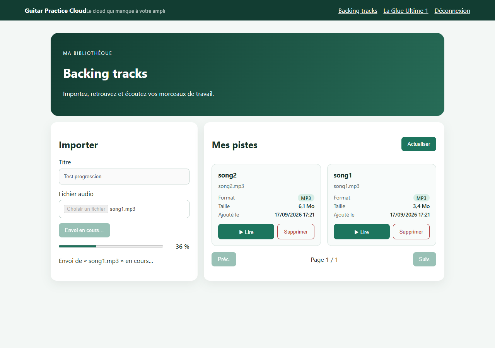
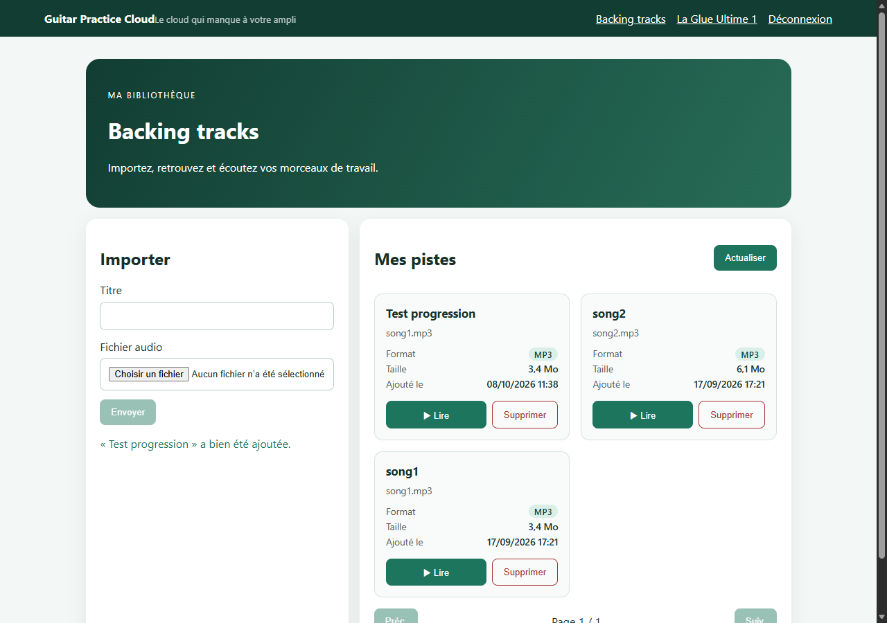
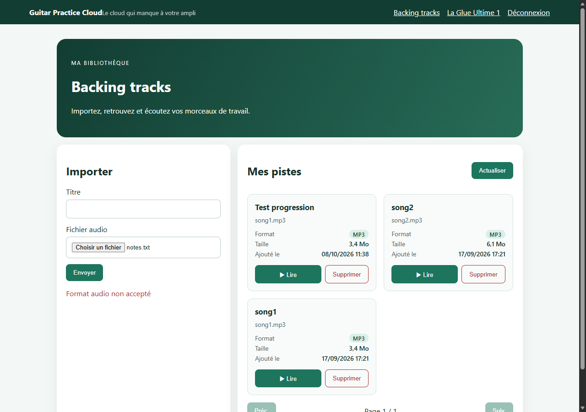
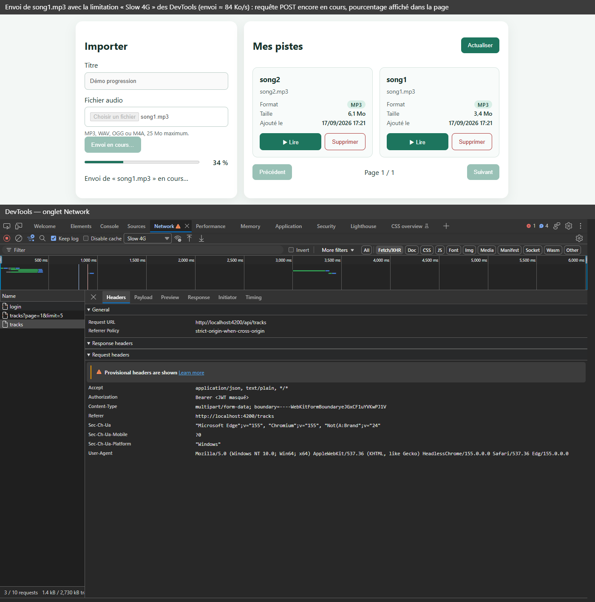

# TP3 — Compte rendu

Travail individuel : Lorenzo Lofredi

Sommaire :

1. [Mission 5 — Suppression d'une piste](#mission-5--suppression-dune-piste)
   - [5.1 Composant et service concernés](#51-composant-et-service-concernés)
   - [5.2 Implémentation](#52-implémentation)
   - [5.3 Tests réalisés](#53-tests-réalisés)
   - [5.4 Pourquoi le guard et l'interface ne suffisent pas](#54-pourquoi-le-guard-et-linterface-ne-suffisent-pas)
   - [5.5 Captures et trace réseau](#55-captures-et-trace-réseau)
2. [Mission 6 — Progression de l'upload](#mission-6--progression-de-lupload)
   - [6.1 Implémentation](#61-implémentation)
   - [6.2 Problème rencontré : pourcentage bloqué à 0 %](#62-problème-rencontré--pourcentage-bloqué-à-0-)
   - [6.3 Pourquoi un upload avec progression se traite différemment](#63-pourquoi-un-upload-avec-progression-se-traite-différemment)
   - [6.4 Vérification dans le navigateur](#64-vérification-dans-le-navigateur)
3. [Mission 7 — Tests automatisés](#mission-7--tests-automatisés)
   - [7.1 Mise en place](#71-mise-en-place)
   - [7.2 Rapport des tests frontend](#72-rapport-des-tests-frontend)
   - [7.3 Extension backend facultative](#73-extension-backend-facultative)
   - [7.4 Limite des tests unitaires constatée](#74-limite-des-tests-unitaires-constatée)
4. [Vérifications finales](#vérifications-finales)
5. [Restitution orale — éléments de réponse](#restitution-orale--éléments-de-réponse)
6. [Livrables TP3 — état](#livrables-tp3--état)

---

## Mission 5 — Suppression d'une piste

### 5.1 Composant et service concernés

Flux : **card de piste → `TracksPageComponent.remove()` → `TrackService.delete()` → `HttpClient` (+ intercepteur JWT) → `DELETE /api/tracks/:id`**

| Rôle | Fichier | Élément |
|---|---|---|
| Interface (bouton dans la card) | `components/tracks-page/tracks-page.html` | `<button class="track-card__delete" (click)="remove(track)">` |
| Logique de l'écran | `components/tracks-page/tracks-page.ts` | `remove()`, `isDeleting()`, `setDeleting()`, `notify()`, `load()` |
| Appel HTTP | `shared/services/track.service.ts` | `delete(id)` → `http.delete<void>('/api/tracks/' + id)` |
| Ajout du JWT, gestion du 401 | `shared/interceptors/auth.interceptor.ts` | Inchangé |
| Contrôle réel côté serveur | `backend/src/app.js` | `app.delete("/api/tracks/:id", auth, …)` → `Track.findOneAndDelete({ _id, ownerId: req.auth.sub })` |

Le composant n'appelle jamais `HttpClient` directement : il passe par `TrackService`.

### 5.2 Implémentation

| Exigence | Implémentation |
|---|---|
| Action « Supprimer » dans chaque card | Bouton à côté de « ▶ Lire », annoncé « Supprimer *titre* » aux lecteurs d'écran |
| Confirmation avant suppression | `confirm('Supprimer définitivement « titre » ?')`. Si l'utilisateur annule, aucune requête n'est envoyée |
| État de suppression contre les doubles clics | Signal `deletingIds` (ensemble des identifiants en cours) : le bouton est désactivé et affiche « Suppression… ». `remove()` ne fait rien si la piste est déjà en cours de suppression |
| Message de succès ou d'erreur (SnackBar) | `MatSnackBar` d'Angular Material : vert pour le succès (4 s, annonce *polite*), rouge pour une erreur (7 s, annonce *assertive*) |
| Mise à jour de la page | `load()` après la suppression. Si la page courante devient vide (dernière piste d'une page > 1), `load()` revient automatiquement à la dernière page existante |
| Piste déjà supprimée ou appartenant à un autre utilisateur | Le backend répond **404** dans les deux cas. Le SnackBar indique « … n'existe plus ou ne vous appartient pas. La liste a été actualisée. », puis la liste est rechargée |
| Session expirée (401) | Déjà gérée par l'intercepteur : déconnexion et retour à `/login` |

Dépendance ajoutée : `@angular/material` et `@angular/cdk` (`~22.1.0`, même version mineure qu'Angular), avec le thème `azure-blue` déclaré dans `angular.json`. Les couleurs du SnackBar sont adaptées à la charte du projet dans `styles.css` (`.snack-success`, `.snack-error`).

### 5.3 Tests réalisés

Test de bout en bout, joué le 02/10/2026 par un script qui pilote Edge (sans fenêtre) avec le compte démo. Les pistes de test ont été créées pour l'occasion, puis supprimées.

| # | Scénario | Résultat attendu | Résultat observé | |
|---|---|---|---|---|
| 1 | Clic sur « Supprimer », puis **Annuler** | Aucune requête, piste toujours affichée | Dialogue « Supprimer définitivement « Test suppression A » ? », aucun `DELETE`, piste présente | ✅ |
| 2a | Clic sur « Supprimer », puis **OK** (réseau ralenti) | Bouton désactivé « Suppression… » | `disabled: true`, texte « Suppression… » | ✅ |
| 2b | **Double clic** pendant la suppression | Une seule requête `DELETE` | Un seul `DELETE /api/tracks/…83 → 204` | ✅ |
| 2c | Fin de la suppression | SnackBar de succès et liste rechargée sans la piste | « « Test suppression A » a été supprimée. » ; liste : Test suppression B, song2, song1 | ✅ |
| 3a | Piste supprimée **dans un autre onglet** mais encore affichée, puis clic sur « Supprimer » | Le backend répond 404 | `DELETE /api/tracks/…84 → 404` | ✅ |
| 3b | Message affiché | SnackBar d'erreur explicite | « « Test suppression B » n'existe plus ou ne vous appartient pas. La liste a été actualisée. » | ✅ |
| 3c | Liste | La piste disparaît | Liste : song2, song1 | ✅ |
| 4 | `DELETE` envoyé **sans JWT** (hors interface) | 401 | `401` | ✅ |

**Résultat : 11 vérifications sur 11 réussies.** La première exécution en avait signalé une en échec : c'était une erreur du script de test, qui lisait la requête de « l'autre onglet » (204) au lieu de celle de l'interface (404). Le script a été corrigé, pas l'application.

**Piste d'un autre utilisateur** (testé le 16/10/2026 avec un second compte réel, `verif-proprietaire-…@example.com`) : avec le JWT de ce compte, `DELETE /api/tracks/<id de song1>`, une piste du compte démo, renvoie **404** `{"message":"Piste inconnue"}`. La piste reste intacte et le compte démo peut toujours la lire (200). Le backend (`findOneAndDelete({ _id, ownerId })`) renvoie donc le même 404 que pour une piste inexistante, et l'interface affiche le même message qu'au test 3b. Détail : [COMPTE_RENDU_TP2.md, section D](../tp2/COMPTE_RENDU_TP2.md#d-démonstration-de-la-lecture-audio-authentifiée), tests 7 à 10.

### 5.4 Pourquoi le guard et l'interface ne suffisent pas

- **Le guard ne protège que la navigation Angular.** `authGuard` empêche d'afficher `/tracks` sans token. Il ne s'exécute que dans le navigateur, uniquement lors d'un changement de route, et il ne regarde pas les requêtes HTTP. N'importe qui peut envoyer une requête à l'API sans passer par Angular : `curl`, Postman, la console du navigateur, un autre site…
- **L'interface ne contrôle que ce qui est affiché.** Masquer ou désactiver un bouton n'empêche pas d'envoyer `DELETE /api/tracks/<id>` à la main. Le code JavaScript du frontend est public et modifiable par l'utilisateur, donc tout contrôle fait côté client peut être contourné.
- **C'est le backend qui protège réellement la suppression**, à deux niveaux (`app.js`) :
  1. **Authentification** : le middleware `auth` vérifie la signature et la date d'expiration du JWT avec un secret que seul le serveur connaît. Sans JWT valide, la réponse est **401** (test 4).
  2. **Autorisation (propriétaire)** : `Track.findOneAndDelete({ _id: req.params.id, ownerId: req.auth.sub })`. La piste n'est supprimée que si elle appartient à l'utilisateur identifié **par le token**, et non par une donnée envoyée par le client. Sinon, la réponse est **404**. Renvoyer 404 plutôt que 403 évite aussi de révéler qu'une piste existe chez un autre utilisateur.
- **Conclusion** : le guard et l'interface améliorent l'expérience (pas d'écran inutile, confirmation, messages clairs), mais la **sécurité** repose uniquement sur les vérifications du serveur.

### 5.5 Captures et trace réseau

| Card avec « Supprimer » | Suppression en cours |
|---|---|
|  |  |

**Succès** (SnackBar vert, liste rechargée) :



**Piste déjà supprimée ailleurs** (404, SnackBar rouge, liste actualisée) :



Trace réseau ([captures/network-trace-suppression.txt](captures/network-trace-suppression.txt)), token masqué :

```text
DELETE /api/tracks/…83  →  204   Authorization: Bearer ***   (suppression confirmée, une seule malgré le double clic)
GET    /api/tracks?page=1&limit=5  →  200                    (rechargement)
DELETE /api/tracks/…84  →  204   (simulation : suppression depuis un autre onglet)
DELETE /api/tracks/…84  →  404   Authorization: Bearer ***   (clic dans l'interface sur la piste déjà supprimée)
GET    /api/tracks?page=1&limit=5  →  200                    (actualisation)
DELETE /api/tracks/…83  →  401   Authorization: (absent)     (sans JWT)
```

**Capture DevTools** (16/10/2026, Edge piloté par script, vraie boîte de confirmation acceptée, JWT remplacé par `<JWT masqué>`). On y voit :
- le SnackBar « « Démo progression » a été supprimée. » et la liste rechargée sans la piste ;
- dans les DevTools : `DELETE /api/tracks/:id` → **204 No Content**, avec `Authorization: Bearer <JWT masqué>` dans les *Request headers*, suivi du `GET /api/tracks?page=1&limit=5` de rechargement.



Trace et résultats de ce passage : [captures/network-trace-captures-devtools.txt](captures/network-trace-captures-devtools.txt), [captures/resultats-captures-devtools.json](captures/resultats-captures-devtools.json) (11 vérifications sur 11).

---

## Mission 6 — Progression de l'upload

Flux : **formulaire d'upload → `TracksPageComponent.upload()` → `TrackService.upload()` → `HttpClient` (`reportProgress`, `observe: 'events'`) → événements de progression → Signals → template**

### 6.1 Implémentation

| Fichier | Modification |
|---|---|
| `shared/services/track.service.ts` | `upload()` passe `{ reportProgress: true, observe: 'events' }` à `http.post`. L'Observable n'émet plus seulement le `Track` : il émet une suite de `HttpEvent<Track>` |
| `components/tracks-page/tracks-page.ts` | Type `UploadStatus` et Signal `uploadStatus` ; `uploading` devient un `computed` ; Signal `uploadProgress` (0 à 100) ; `upload()` trie les événements reçus |
| `components/tracks-page/tracks-page.html` | Barre `<progress>` et pourcentage, affichés uniquement pendant l'envoi |
| `components/tracks-page/tracks-page.css` | Mise en forme de la barre |
| `main.ts` | `provideHttpClient(withXhr(), …)` (voir 6.2) |

Les quatre états demandés sont portés par le Signal `uploadStatus` :

| État | Valeur | Ce que voit l'utilisateur |
|---|---|---|
| Aucun envoi en cours | `'idle'` | Bouton « Envoyer » (désactivé tant qu'aucun fichier n'est choisi), pas de barre |
| Envoi en cours | `'uploading'` | Barre de progression + « 36 % », bouton « Envoi en cours… », message « Envoi de « fichier » en cours… » |
| Réussite | `'success'` | Message vert « « titre » a bien été ajoutée. », formulaire vidé, page 1 rechargée |
| Échec | `'error'` | Message rouge du serveur (par exemple « Format audio non accepté »), fichier conservé pour un nouvel essai |

Choisir un autre fichier remet l'état à `'idle'`.

**Calcul du pourcentage** : pendant l'envoi, le navigateur émet des événements `HttpEventType.UploadProgress` qui contiennent `loaded` (octets déjà envoyés) et `total` (taille du corps de la requête). Le composant calcule :

```ts
Math.round((100 * event.loaded) / event.total)
```

`total` peut être absent si le navigateur ne connaît pas la taille : dans ce cas, le dernier pourcentage connu est conservé.

**Contrôles désactivés et double soumission** : pendant l'envoi, le bouton, le champ fichier et le champ titre sont désactivés. `upload()` ne fait rien si `uploading()` est déjà vrai, ce qui protège aussi contre un appel qui ne passerait pas par le bouton.

**Données sensibles** : la console ne reçoit que le nom du fichier choisi, l'identifiant de la piste créée et le statut HTTP d'une erreur. Ni le JWT, ni le mot de passe, ni l'objet d'erreur complet ne sont journalisés.

### 6.2 Problème rencontré : pourcentage bloqué à 0 %

À la première vérification dans le navigateur, l'envoi durait bien 8 secondes (réseau ralenti) mais l'interface restait à « 0 % » jusqu'à la fin, alors que les tests unitaires passaient.

- **Cause** : depuis Angular 21, `HttpClient` utilise par défaut l'API `fetch` du navigateur. Or `fetch` ne sait pas rapporter la progression d'un **envoi** : aucun événement `UploadProgress` n'est émis. Le code source d'Angular le dit explicitement (« The FetchBackend does not support upload progress reporting. Please use `withXhr()` »).
- **Correction** : `provideHttpClient(withXhr(), withInterceptors([authInterceptor]))` dans `main.ts`. `HttpClient` repasse par `XMLHttpRequest`, dont l'événement `upload.onprogress` fournit `loaded` et `total`.
- **Après correction** : 73 valeurs distinctes affichées de 0 % à 100 % pendant le même envoi.

### 6.3 Pourquoi un upload avec progression se traite différemment

- **Requête classique** : l'Observable émet **une seule valeur**, le corps de la réponse, puis se termine. Le `next` du `subscribe` peut donc traiter directement le résultat (`next: (track) => …`).
- **Upload avec progression** : avec `observe: 'events'`, l'Observable émet **plusieurs valeurs de types différents** dans le temps :
  1. `Sent` : la requête est partie ;
  2. `UploadProgress` (plusieurs fois) : `loaded` et `total` ;
  3. `ResponseHeader` : le statut et les en-têtes sont arrivés ;
  4. `Response` : la réponse finale, avec le `Track` dans `body`.
- **Conséquences dans le code** :
  - le `next` est appelé de nombreuses fois : il faut **tester `event.type`** avant d'agir, sinon on traiterait chaque événement de progression comme un succès ;
  - le résultat n'est plus la valeur émise mais `event.body`, uniquement sur l'événement `Response` ;
  - il faut un **état intermédiaire** (le pourcentage) en plus des états « en cours / terminé » ;
  - l'option `reportProgress` doit être demandée explicitement, et le backend HTTP utilisé doit la prendre en charge (voir 6.2) ;
  - la gestion des erreurs ne change pas : un statut 400 ou une coupure réseau arrive toujours dans `error`.
- **Limite** : le pourcentage mesure les octets **envoyés par le navigateur**, pas le traitement côté serveur. À 100 %, il reste à attendre la réponse (écriture sur disque, enregistrement MongoDB). C'est pourquoi l'état ne passe à `'success'` qu'à la réception de l'événement `Response`.

### 6.4 Vérification dans le navigateur

Test de bout en bout joué le 08/10/2026 par un script qui pilote Edge (sans fenêtre) avec le compte démo, backend et MongoDB réels. Le débit d'envoi est limité à 450 Ko/s pour rendre la progression observable. La piste de test a été supprimée à la fin.

| # | Scénario | Résultat attendu | Résultat observé | |
|---|---|---|---|---|
| 1 | Page chargée, aucun fichier | Pas de barre, bouton « Envoyer » désactivé | Pas de barre, bouton désactivé | ✅ |
| 2 | Envoi de `song1.mp3` (3,4 Mo) | Pourcentage affiché, identique à la barre | Barre à 36, texte « 36 % » | ✅ |
| 3 | Pendant l'envoi | Bouton, champ fichier et titre désactivés | Les trois désactivés, bouton « Envoi en cours… » | ✅ |
| 4 | Progression | Valeurs strictement croissantes | 0 → 3 → 5 → … → 95 → 98, puis 100 | ✅ |
| 5 | Fin de l'envoi | Message de succès, barre masquée, formulaire vidé | « « Test progression » a bien été ajoutée. » | ✅ |
| 6 | **Double clic** sur « Envoyer » | Une seule requête `POST` | Un seul `POST /api/tracks → 201` | ✅ |
| 7 | Requête d'upload | `multipart/form-data` avec JWT | `multipart/form-data; boundary=…`, `Authorization: Bearer ***` | ✅ |
| 8 | Liste | La nouvelle piste apparaît | « Test progression » en tête de la page 1 | ✅ |
| 9 | Envoi de `notes.txt` | Message du serveur, nouvel essai possible | « Format audio non accepté », bouton réactivé | ✅ |
| 10 | Statut de la requête refusée | 400 | `POST /api/tracks → 400` | ✅ |
| 11 | Console | Ni JWT ni mot de passe | Aucune ligne suspecte | ✅ |
| 12 | Console | Aucune erreur inattendue | Uniquement le 400 du fichier refusé | ✅ |

**Résultat : 13 vérifications sur 13 réussies** (la 13ᵉ est le nettoyage de la piste de test, `DELETE → 204`). Détail : [captures/resultats-tests-upload.json](captures/resultats-tests-upload.json).

| Envoi en cours (36 %) | Réussite | Échec |
|---|---|---|
|  |  |  |

Trace réseau ([captures/network-trace-upload.txt](captures/network-trace-upload.txt)), token masqué :

```text
POST   /api/auth/login             →  200   Authorization: (absent)     Content-Type: application/json
GET    /api/tracks?page=1&limit=5  →  200   Authorization: Bearer ***
POST   /api/tracks                 →  201   Authorization: Bearer ***   Content-Type: multipart/form-data; boundary=…
GET    /api/tracks?page=1&limit=5  →  200   Authorization: Bearer ***   (rechargement de la page 1)
POST   /api/tracks                 →  400   Authorization: Bearer ***   (notes.txt refusé)
DELETE /api/tracks/…6e1e           →  204   Authorization: Bearer ***   (nettoyage)
```

**Capture DevTools pendant l'envoi** (16/10/2026). Le débit est limité avec le profil « Slow 4G » des DevTools, soit environ 84 Ko/s en envoi, et l'envoi de `song1.mp3` dure environ 43 s. La capture est prise vers 35 %. On y voit :
- la page : barre de progression et « Envoi en cours… » désactivé ;
- les DevTools : le `POST /api/tracks` **encore en cours** (pas de statut, en-têtes provisoires), `Content-Type: multipart/form-data; boundary=…` et `Authorization: Bearer <JWT masqué>` ;
- le menu de limitation affiche « Slow 4G », et l'icône ⚠ sur l'onglet Network signale que le débit est limité.

À la fin : un seul `POST → 201`, un message de succès, puis la piste est supprimée par la capture ci-dessus.



> Depuis le 16/10, `notes.txt` (scénarios 9 et 10 ci-dessus) est refusé **avant** l'envoi par la validation frontend du TP2. Le `POST → 400` n'est donc plus envoyé depuis l'interface. Le traitement de l'erreur serveur reste couvert par le test unitaire « passe à l'état error… » et par les tests backend.

---

## Mission 7 — Tests automatisés

### 7.1 Mise en place

Le projet n'avait aucun test frontend et `ng test` ne démarrait pas. Trois ajustements de configuration ont été nécessaires :

| Élément | Raison |
|---|---|
| `jsdom` ajouté aux `devDependencies` | `ng test` exige un DOM simulé pour exécuter les tests hors navigateur |
| `angular.json` : `test.options.buildTarget = "gpc:build"` | Par défaut, le lanceur cherche une configuration `development` qui n'existe pas dans ce projet |
| `tsconfig.spec.json` (nouveau) ; `*.spec.ts` exclus de `tsconfig.app.json` | Les tests ont leur propre configuration et ne font pas partie du build de l'application |

Commande : `npm test` dans `frontend-starter/` (Vitest 4.1, lancé par `ng test --watch=false`).

**Principe commun** : `provideHttpClientTesting()` remplace le vrai transport HTTP par `HttpTestingController`. Aucune requête ne quitte le test. Chaque test :

1. déclenche l'action (méthode du service ou du composant) ;
2. récupère la requête avec `expectOne(...)` et vérifie sa méthode, son URL, ses paramètres, ses en-têtes et son corps ;
3. simule la réponse avec `flush(...)` ou un événement avec `event(...)` ;
4. vérifie le résultat (Signals, DOM, appels).

`http.verify()` en fin de test échoue si une requête inattendue est partie. Les tests ne dépendent donc ni du backend ni de MongoDB.

### 7.2 Rapport des tests frontend

Exécution du 08/10/2026 : **5 fichiers, 24 tests, 24 réussis**. Les sept tests proposés par le sujet sont couverts (colonne « Sujet »).

**`shared/services/track.service.spec.ts`**

| Test | Résultat attendu | Observé | Sujet |
|---|---|---|---|
| `list()` transmet `page` et `limit` | `GET /api/tracks?page=3&limit=10` | ✅ | ✔ |
| `list()` sans argument | `GET /api/tracks?page=1&limit=5` | ✅ | |
| `delete()` | `DELETE /api/tracks/t1`, sans corps | ✅ | |
| `upload()` | `POST /api/tracks`, `FormData` avec exactement `audio` et `title`, `reportProgress` actif, événements `UploadProgress` puis `Response` | ✅ | |

**`shared/services/auth.service.spec.ts`**

| Test | Résultat attendu | Observé | Sujet |
|---|---|---|---|
| `login()` | `POST /api/auth/login`, corps `{ email, password }` | ✅ | ✔ |
| `login()` réussi | Token dans le Signal et dans `localStorage`, `currentUser` renseigné | ✅ | |
| `login()` avec un 401 | Rien n'est mémorisé | ✅ | |
| `logout()` | Token et utilisateur effacés | ✅ | |

**`shared/interceptors/auth.interceptor.spec.ts`**

| Test | Résultat attendu | Observé | Sujet |
|---|---|---|---|
| Token présent | En-tête `Authorization: Bearer jeton-de-test` | ✅ | ✔ |
| Pas de token | Pas d'en-tête `Authorization` | ✅ | |
| Route `/api/auth/*` avec token | Pas d'en-tête `Authorization` | ✅ | |
| Réponse 401 | Token effacé, navigation vers `/login?expired=1`, erreur propagée | ✅ | |
| 401 sur `/api/auth/login` | Pas de déconnexion ni de redirection | ✅ | |

**`shared/guards/auth.guard.spec.ts`**

| Test | Résultat attendu | Observé | Sujet |
|---|---|---|---|
| Sans token | `UrlTree` vers `/login?returnUrl=%2Ftracks` | ✅ | ✔ |
| Avec token | `true` | ✅ | |

**`components/tracks-page/tracks-page.spec.ts`**

| Test | Résultat attendu | Observé | Sujet |
|---|---|---|---|
| Chargement initial | Les pistes renvoyées sont affichées | ✅ | |
| Suppression confirmée | `DELETE /api/tracks/t1`, puis nouveau `GET /api/tracks?page=1&limit=5`, piste absente du DOM, SnackBar « « Blues » a été supprimée. » | ✅ | ✔ |
| Confirmation annulée | Aucune requête, pas de SnackBar | ✅ | |
| Double clic sur « Supprimer » | Un seul `DELETE` | ✅ | |
| Suppression avec un 404 | SnackBar « … n'existe plus ou ne vous appartient pas… », liste rechargée | ✅ | |
| Aucun envoi lancé | État `idle`, 0 %, pas de barre | ✅ | |
| Progression | 50/200 octets → 25 % (Signal, texte et barre) ; 150/200 → 75 % ; réponse 201 → `success`, 100 %, formulaire vidé, liste rechargée | ✅ | ✔ |
| Seconde soumission pendant l'envoi | Un seul `POST` | ✅ | |
| Échec HTTP (400) | État `error`, message « Format audio non accepté » dans l'élément `role="alert"`, fichier conservé | ✅ | ✔ (deux tests du sujet) |

**Les tests détectent-ils vraiment une erreur ?** Vérifié par une modification volontaire : en remplaçant `100 * event.loaded` par `50 * event.loaded` dans le composant, le test de progression échoue (« expected 13 to be 25 »). Le code a ensuite été rétabli.

### 7.3 Extension backend facultative

Six tests ajoutés à `backend/test/api.test.js`, sans modifier les routes. Les deux tests existants sont conservés. Commande : `npm test` dans `backend/` : **8 tests, 8 réussis**.

| Test | Résultat attendu | Observé |
|---|---|---|
| `GET /api/tracks` sans JWT | 401, « Authentification requise » | ✅ |
| `DELETE /api/tracks/:id` sans JWT | 401 | ✅ |
| JWT mal formé | 401, « Jeton invalide ou expiré » | ✅ |
| JWT signé avec un autre secret | 401 | ✅ |
| Upload sans fichier (JWT valide) | 400, « Fichier audio requis » | ✅ |
| Upload d'un fichier `text/plain` | 400, « Format audio non accepté » | ✅ |

Ces six cas sont rejetés par un middleware (`auth` ou Multer) **avant** tout accès à la base : ils tournent sans MongoDB.

**Non réalisés** : la pagination avec `page` et `limit`, et l'accès à la piste d'un autre utilisateur. Ces deux tests exécutent de vraies requêtes Mongoose, donc ils demandent une base de test (ou une base en mémoire à installer).

### 7.4 Limite des tests unitaires constatée

Le problème du 6.2 montre la différence entre les deux niveaux de test :

- les **tests unitaires** du composant simulent les événements `UploadProgress` avec `HttpTestingController` : ils prouvent que le composant calcule et affiche correctement le pourcentage **si** ces événements arrivent ;
- ils ne peuvent pas voir que le vrai transport HTTP (`fetch`) n'émettait jamais ces événements. Seul le **test dans le navigateur**, avec le vrai `HttpClient` et le vrai backend, l'a révélé.

---

## Vérifications finales

| Vérification | Commande ou moyen | Résultat (08/10/2026) |
|---|---|---|
| Tests frontend | `npm test` dans `frontend-starter/` | ✅ 24 / 24 |
| Tests backend | `npm test` dans `backend/` | ✅ 8 / 8 |
| Build | `npm run build` dans `frontend-starter/` | ✅ « Application bundle generation complete » |
| Network : `DELETE` après confirmation | Trace du 02/10/2026 (section 5.5) + capture DevTools du 16/10 | ✅ `DELETE → 204` |
| Network : upload et progression | Trace du 08/10/2026 (section 6.4) + capture DevTools du 16/10 | ✅ `POST → 201`, 0 % → 100 % |
| Console : pas d'erreur inattendue | Console enregistrée pendant le scénario 6.4 | ✅ Seule erreur : le 400 attendu |
| Console : pas de donnée sensible | Recherche d'un JWT, de `Bearer` et de `password` dans la console | ✅ Aucune occurrence |

Remarque : au premier chargement, le navigateur demande `favicon.ico`, absent du projet (404). Cette erreur existait avant le TP3 et ne concerne pas l'application.

**Nouvelle exécution le 16/10/2026**, après la fin du TP2 :
- `npm test` frontend : **34 / 34** (les 24 tests du TP3 + 10 tests du TP2) ;
- `npm test` backend : **8 / 8** ;
- `npm run build` : OK.

---

## Restitution orale — éléments de réponse

1. **Pourquoi la suppression passe par un service ?** Le composant gère l'écran (confirmation, état, messages) ; `TrackService` est le seul à connaître l'URL et la méthode HTTP. L'appel est réutilisable, et testable séparément : un test vérifie le service, un autre le composant.
2. **Comment le backend protège-t-il la suppression ?** Le middleware `auth` vérifie la signature et l'expiration du JWT (401 sinon), puis `findOneAndDelete({ _id, ownerId: req.auth.sub })` ne supprime que si la piste appartient à l'utilisateur du token (404 sinon). Voir 5.4.
3. **Comment Angular calcule-t-il le pourcentage ?** Angular ne le calcule pas : il transmet les événements `UploadProgress` du navigateur avec `loaded` et `total`. Le composant calcule `Math.round(100 * loaded / total)`. Voir 6.1.
4. **Pourquoi les tests HTTP n'ont-ils pas besoin de MongoDB ?** `provideHttpClientTesting()` remplace le transport : la requête est interceptée dans le test, qui fournit lui-même la réponse. Le backend n'est jamais appelé. Voir 7.1.
5. **Que vérifie un test d'intercepteur ou de guard ?** Intercepteur : la requête qui sort porte (ou non) l'en-tête `Authorization`, et un 401 déclenche la déconnexion. Guard : la valeur renvoyée est `true` avec un token, ou une redirection vers `/login` sans token.
6. **Test unitaire ou test d'intégration ?** Un test unitaire vérifie un élément isolé, ses dépendances étant simulées (les 24 tests frontend). Un test d'intégration vérifie que plusieurs éléments réels fonctionnent ensemble (le scénario navigateur du 6.4 : Angular, proxy, Express, Multer, MongoDB). Le 7.4 donne un exemple de défaut que seul le second a détecté.

---

## Livrables TP3 — état

| Livrable | Où | État |
|---|---|---|
| Suppression fonctionnelle d'une piste | Mission 5 | ✅ Fait |
| Progression d'upload | Mission 6 | ✅ Fait |
| Au moins trois tests frontend | Mission 7 : 24 tests, les 7 du sujet couverts | ✅ Fait |
| Rapport des tests avec résultats attendus et observés | Sections 5.3, 6.4, 7.2 et 7.3 | ✅ Fait |
| Capture Network d'une suppression et d'un upload | Captures DevTools `network-delete.png` (5.5) et `network-upload-progression.png` (6.4), plus les traces réseau | ✅ Fait |
| `npm run build` exécuté | Vérifications finales | ✅ Fait (08/10 et 16/10) |
| Rapport IA | `RAPPORT_IA_MODELE.md`, partie TP3 | ✅ Fait ; rubriques « maitre » à compléter |

**Reste à faire** : remplir les rubriques « maitre » du rapport IA (relectures, ce que je sais expliquer) et s'entraîner à la restitution orale.
